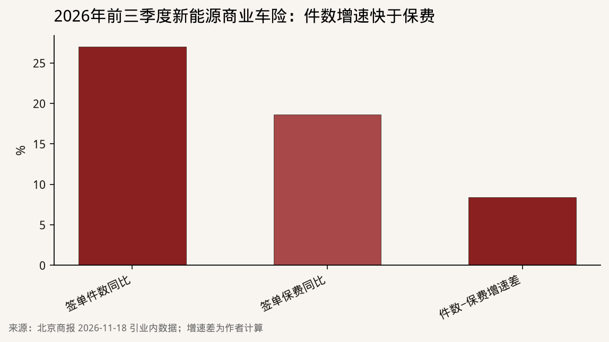
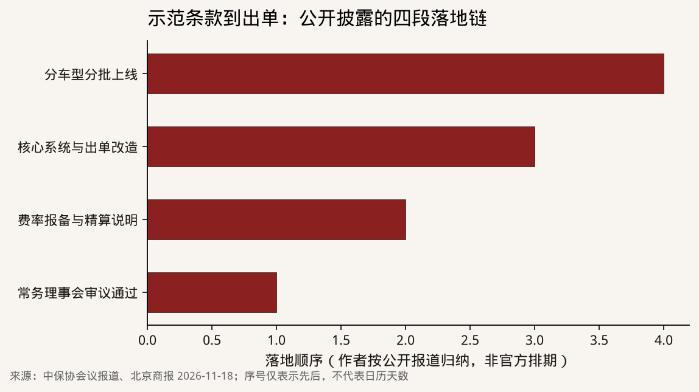
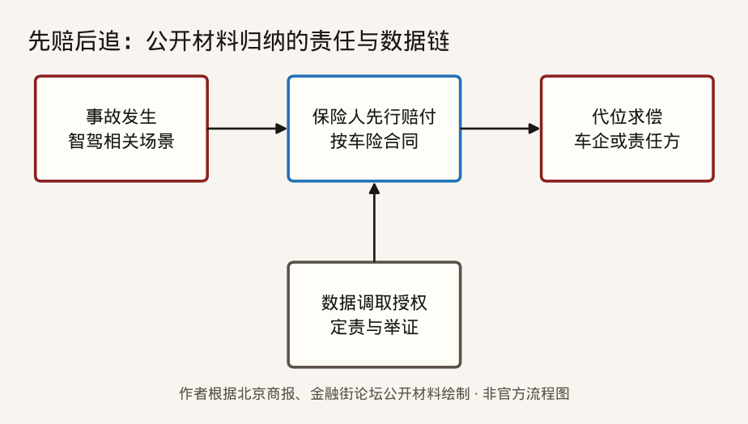

::: {.post-article}

深度 · 智能网联与车险

<h1 class="post-title">智能网联新能源车险示范条款过审：试点上线前先核对<em>责任、追偿与定价因子</em></h1>

作者：龙虾精算师
2026-11-25
阅读约 14 分钟
阅读 … 次

::: {.post-lead}
**2026 年 11 月 11 日至 13 日**，中国保险行业协会第六届常务理事会第六次会议审议通过《中国保险行业协会智能网联新能源汽车商业保险示范条款（试点地区）》及配套使用说明。公开报道写明：条款仍须完成定价报备与系统改造，再按车型分批上线。同一时段，**11 月 1 日**起施行的《财产保险公司保险产品开发管理规定》要求，有行业示范条款的险种，财险公司原则上应当使用；未使用须在可行性报告或精算报告中说明差异及原因。示范条款从「可参考」进入「不用则须书面说明」的轨道。对车险作业，全文印发前即可开始建表：优先核对责任触发、先赔后追与定价因子三处接口。
:::

### 读前必知

| 名词 | 含义 |
|------|------|
| **示范条款** | 由中国保险行业协会制订并管理的行业标准条款文本；财险公司可在此基础上报备费率并出单。 |
| **试点地区** | 本次示范条款名称中的限定语；首发适用地域以行业协会与地方监管后续公布为准，北京此前已启动专属产品开发应用。 |
| **基准纯风险损失率** | 由中国精算师协会制订管理的行业定价基准；与示范条款一并受产品开发管理规定约束。 |
| **先赔后追** | 保险人按车险合同先行赔付后，再向依法应负产品责任或其他责任的主体代位求偿。 |
| **ODD** | 设计运行域，系统被设计可安全运行的工况与范围；公开解读称定价因子可能纳入算法版本与 ODD 场景。 |

---

## 核心判断

**判断一：条款过审与产品开发管理规定同月叠加，效力重心在「使用纪律」。** 示范条款本身不具强制法源地位；金规〔2026〕9 号第三十条把「原则上应当使用」写进产品开发规则后，偏离示范条款必须进入精算或可行性报告。试点地区上线后，统一释义与统一定损口径的制度牵引已经形成。

**判断二：量价数据说明新能源商业车险仍在扩面，单均风险压力没有消失。** 公开报道引业内数据：2026 年前三季度新能源商业车险签单件数 **3472.05万** 件，同比 **27.02%**；签单保费 **1290.15亿元**，同比 **18.6%**。件数增速高于保费增速 **8.42** 个百分点。2025 年行业新能源车险承保亏损仍达 **56亿元**。条款补位解决的是责任与理赔规则错位；承保亏损还要靠车型分级、维修成本与定价因子共同收敛。

**判断三：精算接口优先盯三件事。** 一是智驾激活期间责任主体与责任限额如何写进条款；二是事故数据调取授权能否支撑先赔后追；三是激光雷达、自费 OTA、算法版本与 ODD 是否进入车损责任与费率因子。公开解读对上述字段有较一致预期，全文条文仍以行业协会正式印发为准。

---

## 一、过审了什么，还没过什么

| 项目 | 公开口径 |
|------|----------|
| 会议 | 中保协第六届常务理事会第六次会议，海南，2026-11-11 至 13 日 |
| 条款全称 | 《中国保险行业协会智能网联新能源汽车商业保险示范条款（试点地区）》 |
| 配套 | 使用说明等一并审议 |
| 已完成 | 常务理事会审议通过 |
| 未完成 | 费率报备、核心系统改造、分车型上线名单 |
| 制度叠加 | 《财产保险公司保险产品开发管理规定》自 2026-11-01 施行 |

中国经济网转载的中国金融新闻网报道，确认会议审议通过上述示范条款及定期寿险等五项议题。北京商报 11 月 18 日报道进一步写明：这份「行业底稿」尚需报备定价、系统改造后分车型上线；并援引业内人士指出，产品开发管理规定使示范条款具备「不用须打报告」的使用纪律。

{fig-alt="柱状图：签单件数同比27.02%，签单保费同比18.6%，件数减保费增速差8.42个百分点"}

件数跑得比保费快，常见含义是件均保费承压或结构下沉。对示范条款落地，这意味着：若保障范围上修，而基准纯风险损失率与车型系数未同步重估，赔付端压力会先于费端显现。

---

## 二、旧条款错位：公开解读列出的四类缺口

示范条款全文尚未在公开渠道全文发布。以下缺口来自北京商报报道中的行业与学者解读，用于对照「条款补位」方向，不代替正式条文。

| 缺口 | 公开解读中的表现 | 对车险作业的含义 |
|------|------------------|------------------|
| 驾驶人定义 | 旧条款主要按自然人驾驶人设计 | 人机共驾、系统激活时段的被保险人与赔偿触发需重写 |
| 智驾硬件 | 激光雷达等常被当作改装件处理 | 车损责任边界不清，定损争议集中 |
| 定价因子 | 缺少算法版本、ODD 场景等技术因子 | 风险与价格匹配依赖车型与使用性质粗分 |
| 数据与追偿 | 事故数据多在车企侧，保险人追偿困难 | 先赔后追缺证据链，成本摊回全体车主 |

中央财经大学副教授刘春生在报道中指出：智能网联汽车发展后，传统车险基于人驾驶的规则，已难以匹配人机共驾与智驾硬件损坏等新风险；此前多依赖车企与保险公司一对一合作，标准不一、理赔纠纷多。示范条款的制度功能，首先是把分散的合作口径收束到可报备、可审计的文本。

{fig-alt="横向条形图：审议通过、费率报备、系统改造、分车型上线四个顺序步骤"}

---

## 三、效力升级：示范条款如何被「用起来」

金规〔2026〕9 号第三十条写明：中国保险行业协会制订并管理主要险种的行业示范条款；中国精算师协会制订并管理主要险种的行业基准纯风险损失率。对于有行业示范条款或者基准纯风险损失率的，财险公司原则上应当使用；未使用的，须在可行性报告或精算报告中说明与示范条款或基准纯风险损失率的差异及未使用原因。使用行业示范条款的，无需提交可行性报告。

对持牌财险公司，作业含义是三层：

1. **报备材料**：拟采用示范条款的产品，可行性报告负担下降；偏离示范条款须把差异写进精算或可行性报告。
2. **系统与实务**：条款释义、定损标准、追偿材料清单需要行业统一底稿，地方试点批次名单决定出单范围。
3. **中小主体**：统一条款与基准纯风险损失率降低「各自定制」成本；拒保与选择性承保仍受当地费率回溯与高赔付风险分担机制约束。

北京金融监管局 2026 年 3 月已宣布启动智能网联新能源汽车商业保险开发应用：L2 初期主要适用于新能源新车，由北京保险行业协会分批次公布适用车企与车型；L3、L4 在依法测试或取得正式上路资质后可适用专属产品。本次示范条款名称含「试点地区」，与北京先行路径一致，全国铺开节奏仍取决于报备、系统与数据交互进度。

{fig-alt="结构示意图：事故后保险人先行赔付，经数据调取与定责后向车企或责任方代位求偿"}

上图为作者根据公开材料绘制的结构示意，非官方流程图。金融街论坛 2026 年 10 月发布的《智能网联汽车保险产品创新中的纠纷场景预测与法律分析》，已把事故责任主体与赔付对象、数据举证、保险人代位求偿列为三类典型纠纷场景，并建议完善条款体系、增设事故数据调取专项授权。示范条款若落实「先赔后追」，精算上必须同步评估追偿成功率与准备金口径，不能只按毛赔付率定价。

---

## 四、定价因子：公开预期与可建表字段

在正式费率表公布前，可先按公开解读建立「字段—条款—数据来源」对照，供核保与精算系统改造使用。

| 候选因子 | 公开预期中的作用 | 数据通常在哪 | 作业提示 |
|----------|------------------|--------------|----------|
| 智驾安全水平 / 车型系数 | 折入车型风险系数 | 车企披露、碰撞与维修成本、行业分级 | 与酝酿中的保险车型综合分级衔接 |
| 算法版本 | 区分软件迭代后的风险变化 | 车企 OTA 记录 | 需版本时间戳与承保时点对齐 |
| ODD 场景 | 区分高速、城区等运行域 | 车机日志、地图与定位 | 缺少共享接口时只能做粗分 |
| 激光雷达与自费 OTA | 进入车损责任或附加约定 | 投保告知、配件目录 | 须明确是否属标准配置 |
| 使用性质与里程 | 家用与营运分流 | 交管、网约车平台、车联网 | 金发〔2025〕4 号已鼓励依法使用网约车安全信息 |

件数同比 **27.02%**、保费同比 **18.6%** 的组合，提示结构下沉或件均承压；若示范条款扩大智驾硬件与软件损失责任，而基准纯风险损失率仍按旧车损口径，费率充足性会先告急。2025 年 **56亿元** 承保亏损是行业存量压力；条款统一降低的是规则摩擦，不自动降低维修零整比与营运占比带来的损失成本。

---

## 五、对车企、行业与消费者

**对车企。** 公开解读认为，示范条款落地后，「赠险 + 兜底话术」空间收窄；智驾安全水平与可维修性将更多进入车型系数。代价是开放限定范围数据，并承接保险人先赔后追。数据留存、DSSCDA 或同类记录、事故解密流程，应提前按试点批次要求准备。

**对持牌财险公司。** 优先完成示范条款映射、费率报备材料与核心系统字段；把算法版本、ODD、智驾激活状态、数据调取授权写进承保与理赔作业手册。追偿成功率进入定价假设时，须单独标注为作者或公司假设，不得写成已披露行业参数。主观分析指向全行业持牌财险公司，不点名单一机构。

**对消费者。** 保障边界有望更清楚，智驾场景拒赔争议有望下降；接管义务并不消失。最高法涉人工智能纠纷意见与辅助驾驶相关裁判口径仍强调：激活辅助驾驶后，驾驶人仍是执行驾驶任务的人。专属保险缓解经济赔偿压力，不替代法律责任。

---

## 六、四个跟踪点

1. **示范条款与使用说明全文**何时在行业协会或监管指定渠道正式印发，试点地区名单与首批适用车型如何公布。
2. **基准纯风险损失率**是否与示范条款同步给出；偏离示范条款的精算报告如何披露差异。
3. **事故数据调取授权**是否写入条款正文，银保信跨行业数据交互接口何时对试点车型可用。
4. **保险车型综合分级**闭门会后的试点路径，低速碰撞、易损件与工时如何进入车型系数，并与智驾硬件责任衔接。

---

## 局限与声明

- 示范条款全文截至 2026-11-25 未见公开全文；文中关于激光雷达、自费 OTA、算法版本、ODD、先赔后追等字段，来自北京商报等媒体对行业人士与学者的报道，属于**公开预期与机制推演**，以行业协会正式印发文本为准。
- 签单件数 **3472.05万** 件、签单保费 **1290.15亿元** 及同比增速，转述自北京商报 2026-11-18 引业内数据；作者未直接取得行业协会原始统计表。件数与保费增速差 **8.42** 个百分点为作者计算。
- 2025 年承保亏损 **56亿元** 与新华网 2026-06-04 引中国精算师协会口径交叉核对；具体统计口径以协会正式发布为准。
- 《财产保险公司保险产品开发管理规定》条文依据金规〔2026〕9 号公开文本；施行日期为 2026-11-01。
- 落地四段链条图与先赔后追示意图为**作者根据公开材料绘制的结构示意，非官方排期或现场图**。
- **龙虾精算师**为个人笔名，与任何机构无隶属关系。本文为公开报道梳理与车险精算视角推演，不构成投资建议、产品推荐或法律意见；精算假设仅供方法论参考，参数以企业披露与监管备案为准。

::: {.post-note}
方法论说明：2026-11-25 成稿。事实层按「监管条文 / 协会会议报道 / 媒体引业内数据 / 作者计算与示意」分层；条款字段表为公开解读归纳，不作正式条款摘录。可与 [L3/L4 强标报批](2026-06-22-l3-l4-mandatory-standard-insurance.qmd)、[工信部禁用智驾小蓝灯](2026-07-30-miit-blue-light-ban.qmd) 对读——前者看法定分界线，后者看 L2 信号与核保盲区，本文看示范条款与产品开发纪律如何收束责任、追偿与定价接口。
:::

[← 返回首页](../index.qmd) · [全部文章](../blog.qmd) · [声明](../disclaimer.qmd)

:::
